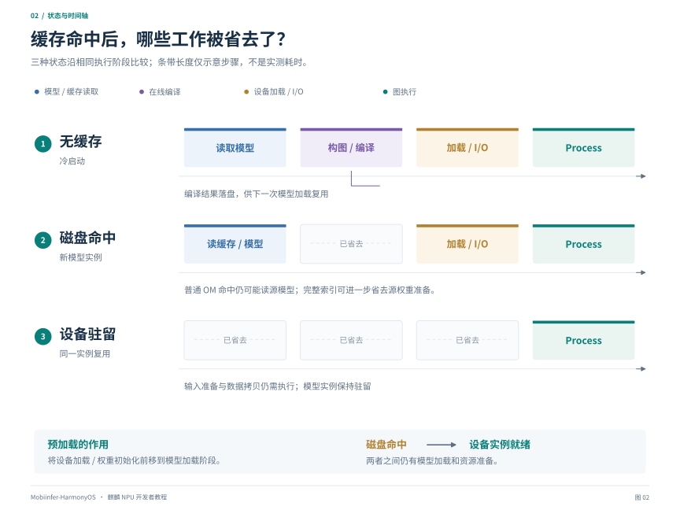

# 第二章：在线编译与 MNN 接入

[教程目录](README.md) · [上一章](01-architecture-and-setup.md) · [下一章：算子开发](03-operators.md)

## 1. 在线编译的完整过程

在线编译将模型计算描述转换为目标设备可执行的图。图的范围由模型、算子支持和资源规划决定，可以覆盖完整网络，也可以是经过划分的子图。以下以本仓库的 MNN HiAI 后端说明接入流程，未命中缓存时经过以下阶段：

```text
MNN 模型与权重
  → MNN 解析、形状推导和后端调度
  → 各 NPU Execution 把算子转换为 HiAI IR
  → ge::Graph / ge::Model
  → HiaiIrBuild::CreateModelBuff / BuildIRModel
  → AiModelMngerClient::Load
  → 查询 I/O 并创建 AiTensor
  → 输入拷贝 → Process → 输出拷贝
```

`onResize` 往往是构图、常量准备和编译发生的位置；并非只有名字包含 `load` 的调用才耗费准备时间。设备端编译可以做算子融合、布局与权重整理，所以首次执行可能明显慢于后续请求。

对应实现见 [NPUBackend.cpp](../../../source/backend/hiai/backend/NPUBackend.cpp)。仓库还包含显式 HiAI 插件和 HCL 能力路径，不能把这些分支的缓存格式、库名和调用顺序与普通 Harmony 路径混为一谈。新增工程应先明确实际走哪个分支。

## 2. 框架级接入示例

### 2.1 先指定正确的后端

本仓库把 HiAI 注册在 **`MNN_FORWARD_USER_0`**。这是框架后端枚举，不是 NNRT 的设备 ID；也不能直接套用其他厂商 NPU 的枚举或配置。

下面是使用本仓库公开 MNN API 的固定形状示例，假定模型只有一个 FP32 NCHW 输入 `input`，形状为 `[1,3,224,224]`，输出名为 `output`。它是集成函数，需要放入已链接 `libMNN.so` 的 Harmony 原生工程；更换模型时必须修改名称、形状与预处理。

```cpp
#include <MNN/Interpreter.hpp>
#include <MNN/expr/ExprCreator.hpp>
#include <MNN/expr/Module.hpp>
#include <algorithm>
#include <memory>

bool runFixedModel(const char* modelFile, const char* cacheDir) {
    using namespace MNN;
    using namespace MNN::Express;

    BackendConfig backend;
    backend.precision = BackendConfig::Precision_Normal;
    ScheduleConfig schedule;
    schedule.type = MNN_FORWARD_USER_0;
    schedule.backupType = MNN_FORWARD_CPU;
    schedule.backendConfig = &backend;

    std::shared_ptr<Executor::RuntimeManager> runtime(
        Executor::RuntimeManager::createRuntimeManager(schedule),
        Executor::RuntimeManager::destroy);
    if (!runtime) return false;

    int actual = -1;
    if (!runtime->getInfo(Interpreter::BACKENDS, &actual) ||
        actual != MNN_FORWARD_USER_0) return false;

    // 可写、跨请求保留的目录；不要传只读资源目录。
    runtime->setExternalPath(cacheDir, Interpreter::EXTERNAL_NPU_FILE_DIR);
    Module::Config config;
    config.dynamic = false;
    config.shapeMutable = false;
    config.rearrange = false;
    std::shared_ptr<Module> module(
        Module::load({"input"}, {"output"}, modelFile, runtime, &config));
    if (!module) return false;

    auto input = _Input({1, 3, 224, 224}, NCHW, halide_type_of<float>());
    auto data = input->writeMap<float>();
    if (!data) return false;
    std::fill(data, data + 1 * 3 * 224 * 224, 0.0f);
    auto outputs = module->onForward({input});
    return outputs.size() == 1 && outputs[0].get() != nullptr &&
           outputs[0]->readMap<float>() != nullptr;
}
```

这个例子允许 CPU backup，因此 Runtime 是 HiAI 仍不能证明全部算子都在 NPU。开发和验收时，要结合实际分图与执行日志；需要严格禁止框架回退时，应使用并检查仓库显式 HiAI 会话协议，不能仅凭设置一个枚举认定“全 NPU”。

示例每次调用都创建模块，便于展示完整顺序。实际应用应将 RuntimeManager 和 Module 作为已加载模型的成员保留，多次 `onForward` 复用；不要按这个函数的生命周期逐帧重建。

### 2.2 固定形状是一项输入契约

`shapeMutable=false` 用于固定输入协议。应在加载前确定各输入的形状、类型和布局；需要多个形状时，设计尺寸或序列长度档位，并分别管理编译产物和驻留资源。

固定模块不应被当成支持所有分离 forward/tracing 模式。当前缓存模块会拒绝不支持的分离执行模式；需要原 Session 语义的优化/跟踪会交回原始模块。

## 3. 执行后端与结果验证

建议逐级检查：

| 证据 | 可以说明什么 | 仍不能说明什么 |
| --- | --- | --- |
| `MNN HIAI compile/cache path enabled` | 调用方启用了相关代码路径 | HiAI 已注册、模型已执行 |
| `RuntimeManager::getInfo(BACKENDS)` 返回 `MNN_FORWARD_USER_0` | 本仓库实际选择了 HiAI Runtime | 没有 CPU 子图、计算成功 |
| `graph_ready` / 缓存 `validated` | 图和相应资源准备成功 | 已完成一次正确推理 |
| `Process` / `RunSync` 成功返回 | 该次设备接口执行完成 | 输出与参考模型一致 |
| 同输入逐层/端到端数值对照 | 被检查范围的数值正确性 | 所有输入、所有设备均正确 |

程序应使用后端枚举名称，并检查实际算子划分。以仓库视觉日志为例，`requested=hiai actual=8 hiai=8` 表示选中了 HiAI Runtime，`actual=0` 表示选中了 CPU；日志中的数字是本仓库枚举值。

## 4. 磁盘缓存如何工作



*图 2：按相同阶段对齐比较三种缓存状态，淡色虚线区表示省去的准备工作。磁盘命中仍需设备加载与 I/O，同实例驻留才可直接复用设备模型；时间轴长度为步骤示意，不是性能数据。*

### 4.1 需要三种不同的测试

1. **无缓存首次运行**：包含构图、在线编译、加载及执行。
2. **有磁盘缓存、重新加载模型**：可跳过在线编译，仍需向设备加载模型并初始化 I/O。
3. **同一个已加载模型重复执行**：图和相关资源已经驻留，主要付出输入准备、拷贝与计算。

把第三种的时间作为第二种的必然结果，会误判缓存未生效。

### 4.2 本项目的缓存目录与开关

`MNN_HIAI_CACHE_OM_BY_CHUNK=ON` 在当前仓库默认开启。`Omni` 在加载每个 chunk 前设置独立 `EXTERNAL_NPU_FILE_DIR`，避免多个 chunk 使用同一目录。

```text
<npu_model_dir>/
└── chunk_0/
    └── om_cache_v3/
        ├── shape_<key>/vision.om
        ├── fast_*.meta
        └── module_cache_v1.meta
```

这是本仓库在线视觉模型的目录实例，根目录由模型配置及 App 指定。通用后端按模型内容和接口标识管理缓存，文件名 `vision.om` 不限定图内只能有视觉算子。`RuntimeManager::setCache()` 不能替代本仓库的 chunk 目录协议；更不能靠查找一个旧版目录判断没有缓存。

缓存标识需要覆盖图、外置源权重、输入/输出形状与格式、精度和运行时版本。元数据还保存实际 DDK I/O 槽位与输出别名；输入顺序应按端口协议确定，不能只依据字节数匹配。

### 4.3 三层命中点的区别

| 命中点 | 跳过什么 | 仍需什么 |
| --- | --- | --- |
| 普通 OM 命中 | 设备在线编译 | 可能已做源模型读取、权重还原和 IR 对象构造 |
| fast resize 命中 | 编译和部分算子 resize/构图准备 | 模块加载、设备加载及 I/O |
| 模块缓存命中 | 合法条件下进一步跳过源 MNN/权重读取 | 读取 OM、设备导入及 I/O |

模块入口只用于满足条件的完整静态设备图。CPU 混合图、内容参与形状推导、元数据或文件代次不可信等情况会保留原路径。缓存不是模型本体的替代交付件，原始 `.mnn` 与权重仍需保留。

## 5. 将设备准备前移到模型加载阶段

当前模块缓存可利用已保存的精确接口描述，在 `Module::load` 返回前加载 OM 并初始化设备缓冲区。同形状首图随后直接执行。

典型日志为：

```text
[NPU_CACHE] module_hit: ... phase=model_load source_weights_loaded=0 load_ms=...
```

这将准备时间计入模型加载，不代表设备初始化工作消失。没有完整索引的旧缓存需要先补齐；第一次在线编译或未知输入形状也无法预先全部完成。当前每个模块的入口索引记录一个接口变体，不应假定任意多个尺寸都能提前驻留。

缓存缺失、损坏、驱动拒绝可触发明确的重建路径；设备已经执行但失败时，不能悄悄用 CPU 结果覆盖错误。运行期间源模型被替换，应重新加载整个模型，避免旧 OM 与新权重混用。

## 6. 需要直接构图时

不使用 MNN 也可以接入公开的 HiAI/NNRT 图接口，但要自己承担张量、算子属性、支持性和生命周期管理。HiAI C++ IR 链路中的核心对象是 `ge::Operator`、`ge::Graph`、`ge::Model`；NNRT 则以 `OH_NNModel`、`OH_NNCompilation`、`OH_NNExecutor` 为核心。

不能把 `ge::Model*` 强转成 `OH_NNModel*`，也不能随意混用两套接口创建的张量。接口与资源对应关系见[第五章](05-runtime-apis.md)。

## 7. 仓库案例：在线分块视觉的混合部署

本节采用 ViT 在 NPU、LLM 在 CPU 的折中实现，说明应用入口与分图方式。前述在线构图、缓存和执行流程不限定于此计算划分。

### 7.1 从发布模型开始

使用同时保留 MNN 视觉资产的[双模式运行包](https://www.modelscope.cn/models/fengerhu1/mobi_2B_offline_npu2_kirin9030_online_v2)，保留完整目录，以根 `config.json` 为入口。

App 中选择：**我的 → 模型与智能体 → 在线 NPU → 对应模型**；聊天页面选择本地模型并发送图片。纯文本请求通常不会触发 ViT，也就没有视觉图编译或新的 chunk OM。

运行包需要包含：

```text
config.json / llm_config.json
llm.mnn / llm.mnn.weight / tokenizer.mtok / embeddings_bf16.bin
visual_pre.mnn / visual_pre.mnn.weight
visual_blocks_npu_0.mnn / visual_blocks_npu_0.mnn.weight
... 共六段 blocks ...
visual_post.mnn / visual_post.mnn.weight
```

在线 MNN 视觉需要对应的 `.mnn` 和权重资产；仅包含 OMC 的离线专用包需重新准备在线资产。原生库修改后，还需重新编译应用。

### 7.2 六段 ViT blocks 的分图选择

在线模型的分段是工程折中，用来控制大图构建、常量准备和设备加载的峰值。它不是 NPU 要求 ViT 必须拆成六段，也不是“每次只能执行四张图”的硬件定律。

当前在线链路：

```text
CPU visual_pre
  → NPU blocks chunk 0 → ... → NPU blocks chunk 5
  → CPU visual_post / DeepStack
  → CPU LLM
```

这些模块各有输入输出边界，可能引入同步、拷贝和布局转换。分图更细不一定更快；应同时测量编译峰值、常驻资源和跨边界开销。

本例的 LLM `backend_type` 与视觉 `visual_blocks_backend_type` 分别控制两部分后端。应按所选部署路径配置；全模型离线 NPU 使用第四章介绍的独立图运行时，需要配套的全模型 OMC 和权重包。相关字段及默认值见 [llmconfig.hpp](../../../transformers/llm/engine/src/llmconfig.hpp)。

## 源码入口

- [Omni 视觉调度](../../../transformers/llm/engine/src/omni.cpp)：视觉后端选择、chunk 目录和执行边界。
- [NPUBackend](../../../source/backend/hiai/backend/NPUBackend.cpp)：构图、编译、缓存加载、I/O 和 Process。
- [CachedGraphModule](../../../express/module/CachedGraphModule.cpp)：文件加载前的缓存检查及预加载。
- [StaticModule](../../../express/module/StaticModule.cpp)：完整模块边界导出。
- [核心后端注册](../../../source/core/Backend.cpp)：HiAI Runtime 注册。
- [显式 HiAI 会话](../../../source/backend/hiai/include/MNNHiAISession.hpp)：插件配置、禁止回退和诊断检查。
