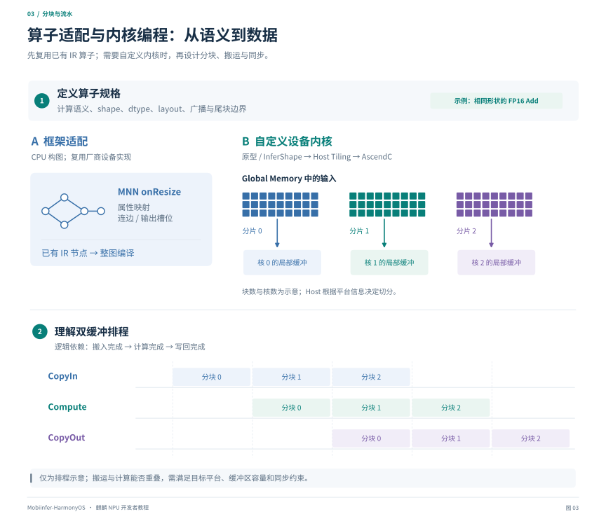

# 第三章：算子适配与 AscendC 开发

[教程目录](README.md) · [上一章](02-online-compilation.md) · [下一章：离线编译](04-offline-and-external-weights.md)

## 1. 先判断是在写哪一种“算子”

| 工作 | 代码运行在哪里 | 主要产物 |
| --- | --- | --- |
| 模型转换规则 | 主机模型转换工具 | 正确的框架算子、属性与权重 |
| MNN HiAI 后端适配 | 手机 CPU 的构图阶段 | HiAI IR 节点及连接关系 |
| AscendC Host 代码 | 工具链规定的主机/运行环境 | 原型、形状推导、Tiling、workspace 信息 |
| AscendC Kernel | NPU 设备计算单元 | 设备可执行计算实现 |



*图 3：左侧展示框架如何映射已有 IR；右侧以分块矩阵说明 Host Tiling 与各核局部缓冲。下方为双缓冲排程示意，实际重叠执行需满足平台与同步约束。两条路线均需完成图集成、CPU 参考及目标设备验证。*

大多数后端接入工作先做第二种。例如将 MNN 的 ReLU 转换成 HiAI `Activation`，调用的是厂商已有内核，并没有重新写一个 NPU ReLU Kernel。

建议按以下顺序选择：

1. 查看 SDK 是否已有语义完全一致的 IR 算子。
2. 查看能否用少量现有算子分解，并评估融合与拷贝开销。
3. 如果只有某个参数或布局不受支持，考虑在导出阶段改写图。
4. 现有实现无法满足功能或性能目标时，再考虑 AscendC 自定义内核。

MatMul 接入失败时，先核对权重格式、转置属性、动态形状与量化参数，再决定是否需要新内核。

## 2. MNN HiAI 后端的算子是怎样工作的

典型实现继承 `NPUCommonExecution`：

- 构造阶段记录算子与参数。
- `onResize` 读取已推导的张量信息，创建 IR、常量并连接输入输出。
- `NPUBackend` 在整段图准备好后编译与加载。
- `NPUCommonExecution::onExecute` 进入后端的 `runGraphOnce()`，由后端控制整段图的实际执行。

因此不能在每个框架节点里都单独加载/执行完整模型，否则会破坏整图调度并放大开销。具体例子见 [NPUActivation.cpp](../../../source/backend/hiai/execution/NPUActivation.cpp)、[NPUReshape.cpp](../../../source/backend/hiai/execution/NPUReshape.cpp) 与 [NPUCommonExecution.cpp](../../../source/backend/hiai/execution/NPUCommonExecution.cpp)。

### 2.1 以 ReLU 的 IR 映射为例

下面是构图核心片段，省略 Creator、参数合法性检查及输出槽位选择。`upstream` 表示已经选择了正确输出槽位的上游算子，`opName` 是本节点唯一名称：

```cpp
auto relu = std::make_shared<hiai::op::Activation>(opName + "_relu");
relu->set_input_x(*upstream)
    .set_attr_mode(1)
    .set_attr_coef(0.0f)
    .set_attr_negative_slope(0.0f);
mNpuBackend->setOutputOps(mOp, {relu}, outputs);
```

`mode=1` 是本项目对应 SDK 使用的 ReLU 映射，不是可跨所有 IR/厂商通用的枚举。写新适配时应查目标 SDK 定义。

适配时需要检查节点与框架算子的**全部语义**是否一致。例如 MNN 的有界激活可以携带一般 `[min,max]`，固定 `[0,6]` 的 ReLU6 只能覆盖其中一种情况。本仓库显式会话路径针对非标准区间使用 `ClipByValue`；其他路径需分别核对支持范围。

### 2.2 一次算子适配应完成哪些工作

| 检查项 | 需要明确的契约 |
| --- | --- |
| 算子变体 | 激活近似方式、Reduce keepDims、MatMul 转置和广播规则 |
| 形状 | rank、标量、空维、广播轴、常量形状输入 |
| 类型 | FP32/FP16/INT32 等实际支持组合，是否发生隐式 Cast |
| 布局 | NCHW/NHWC/NC4HW4 与设备张量之间如何转换 |
| 常量 | 数据长度、生命周期、量化编码和多消费者引用 |
| 输出 | 输出名、输出序号、重复别名、是否存在被优化合并的输出 |
| 不支持情形 | 在适当阶段返回明确错误，或由上层明确选择回退 |

常见的静默错误包括：把 FP32 指针当作 FP16、把 `[B,S,H]` 直接按 NCHW 解释、按相同 byte size 交换了两个输入、把 GELU 的两种定义当成完全相同。

### 2.3 常量与注册

新增适配还要检查 Creator 注册以及实际构建目标是否包含源文件。链接库中存在某个符号，并不证明后端注册函数已经被调用。

本项目禁止新增命名空间作用域的动态初始化对象。不要为了注册算子加入全局 `std::map`、`std::string` 或动态对象；沿用项目的受控注册入口，并检查构建方式对注册的影响。

权重在构图时进入 `Const` 后，若启用了释放主机常量的优化，必须遵守后端引用计数协议。共享权重有多个消费者时，提前释放可能导致偶发数值错误或重建失败。

## 3. AscendC 的适用条件

AscendC 是 CANN Kit 的自定义算子开发路线。编写设备内核时，开发者需要管理数据分块、片上缓冲区、数据搬运与计算同步。支持的平台和接口随 SDK 变化，不能从其他昇腾产品的样例直接推断手机平台可用。

[官方硬件架构抽象](https://developer.huawei.com/consumer/cn/doc/hiai-guides/cannkit-hardware-architecture-abstraction-0000002300239852)介绍了计算、存储和 DMA 的关系。对开发者最有用的区分是：

| 概念 | 用途 |
| --- | --- |
| Global Memory / `GlobalTensor` | 保存模型输入输出等外部存储数据 |
| Local Memory / `LocalTensor` | 核内可计算的局部数据块 |
| Vector | 向量运算，如逐元素、部分归约操作 |
| Cube | 矩阵类计算资源，具体类型/形状需查平台支持 |
| Scalar | 标量控制与索引等逻辑 |
| DMA / DataCopy | Global 与 Local 间的数据搬运 |

不要硬编码其他芯片的核数、UB 容量、对齐粒度或指令限制。Host 侧通过平台信息和输入规格确定分块策略。

## 4. 用 Add 走一遍开发流程

### 4.1 先写清楚规格

初次练习可以限定为：两个形状相同、连续存储的 FP16 ND 张量，输出 `z=x+y`，不做广播、不允许输入输出 alias。先验证一个固定的对齐长度，再扩展到尾块与更多形状。

这一步看似简单，但它决定了 Host 能接受什么、Kernel 应搬多少数据、CPU 参考怎么生成，以及错误是否能在执行前被拒绝。

### 4.2 创建目标平台的算子工程

使用匹配芯片的 DDK/AscendC 环境及工程生成工具。当前案例 DDK 中可见 `tools/tools_ascendc/package/msopgen`；具体参数以该版本帮助和官方工程模板为准，不把服务器版工具命令直接复制到手机插件。

工程至少需要覆盖：

```text
算子工程
├── 原型与规格定义       # 输入、输出、dtype、format、属性
├── InferShape          # 推导输出形状/类型
├── Host Tiling         # 分核、分块、尾块、workspace
├── Kernel              # CopyIn → Compute → CopyOut
├── 编译与安装配置
└── 标杆输入输出与调测配置
```

模板的真实目录和生成文件名因版本而异。上图描述职责，不是要求手动创建一套与工具不同的目录。

### 4.3 Host Tiling 要解决什么

假设有 `N` 个元素，使用 `P` 个核，每块处理 `T` 个元素，需要计算各核的起始位置、有效长度、tile 数和最后一块的有效元素数。

```text
for each core:
    core_begin, core_count = split(N, P, core_id)
    for each tile within this core:
        count = min(T, remaining)
        CopyIn(x, y, count)
        ComputeAdd(count)
        CopyOut(z, count)
```

这是算法伪代码。真实实现必须选择满足平台对齐约束的数据搬运 API。不能把 `count` 简单向上取整后读取输入末尾之外的内存，也不能因为输入元素数对齐，就假定每个核的切片都对齐。

若采用 double buffer，要将队列深度、输入/输出缓冲区、计算临时区一起计入片上内存。增加 tile 或缓冲份数不一定更快，可能超过容量或降低并行度。

### 4.4 Kernel 的核心结构

以下为单块流程片段，用来说明 API 角色，不包含可独立运行的完整内核：

```cpp
// 前置：GlobalTensor、队列、缓冲区与 count 已按平台约束初始化。
auto xLocal = inQueueX.AllocTensor<half>();
auto yLocal = inQueueY.AllocTensor<half>();
AscendC::DataCopy(xLocal, xGlobal[offset], count);
AscendC::DataCopy(yLocal, yGlobal[offset], count);
inQueueX.EnQue(xLocal);
inQueueY.EnQue(yLocal);

xLocal = inQueueX.DeQue<half>();
yLocal = inQueueY.DeQue<half>();
auto zLocal = outQueue.AllocTensor<half>();
AscendC::Add(zLocal, xLocal, yLocal, count);
outQueue.EnQue(zLocal);
inQueueX.FreeTensor(xLocal);
inQueueY.FreeTensor(yLocal);

zLocal = outQueue.DeQue<half>();
AscendC::DataCopy(zGlobal[offset], zLocal, count);
outQueue.FreeTensor(zLocal);
```

队列和同步是确保搬运完成后再计算、输出就绪后再写回的一部分。不要为了简化代码删掉必要的同步。完整 Add 教学及合法参数参见[官方矢量编程示例](https://developer.huawei.com/consumer/cn/doc/hiai-guides/cannkit-vector-programming-0000002157683241)。

### 4.5 从 Kernel 到模型图还差什么

能编译 Kernel 只是第一步。要让模型使用它，还需要：

1. 注册算子原型和形状/类型推导。
2. 让导出的 ONNX 或框架图包含可识别的算子节点及属性。
3. 完成对应解析/映射，确保算子名称、输入输出顺序一致。
4. 将 Host 信息和 Kernel 交付件安装到匹配平台的工具目录。
5. 重新编译模型，检查编译器实际选择了该实现。
6. 按目标 SDK 的部署方式提供设备所需文件，并验证运行。

[官方算子包安装说明](https://developer.huawei.com/consumer/cn/doc/HarmonyOS-Guides/cannkit-operator-package-deployment)描述了编译结果进入 DDK 平台目录的流程；[算子部署入口](https://developer.huawei.com/consumer/cn/doc/HarmonyOS-Guides/cannkit-deploying-operators)区分了入图和框架适配。主机目录安装与手机侧部署是两个阶段。

本项目运行时出现 `No custom_opp rawfile resources, skip custom OPP setup`，只表示没有附加该类资源；使用 SDK 已有算子的模型可以正常工作。不能根据这句日志判断 NPU 未启动，也不能假定任意自定义包都无需部署。

## 5. 如何验证与优化一个算子

### 5.1 先验证数值与边界

- 正常尺寸、最小尺寸、非整 tile 尾部、大尺寸。
- 负值、零、较大幅值以及规格允许的极值。
- dtype、layout、属性的所有已声明组合。
- 多核覆盖完整且无重叠；输出写入范围正确。
- 明确不支持广播、alias 或特殊值时，在 Host 阶段拒绝。

CPU 孪生调试可检查算法、索引、部分搬运与同步问题；Simulator 可提供相应的仿真与调测能力。二者都不能替代目标手机的性能和驱动集成验收。Tiling 相关工具入口见[官方 Tiling 调测](https://developer.huawei.com/consumer/cn/doc/hiai-guides/cannkit-tiling-tuning-0000002157601565)。

### 5.2 再根据瓶颈优化

逐元素 Add 往往对搬运更敏感；矩阵乘可能受 tile、布局转换和矩阵单元利用率影响；小算子可能主要耗在下发与同步。对准实际瓶颈选择融合、分块或数据复用，不用代码行数推断性能。

最终比较应包含图级收益：一个更快的孤立 Kernel 如果增加了两次 CPU/NPU 往返，可能让整个模型更慢。

## 源码与继续阅读

- [MNN HiAI 算子目录](../../../source/backend/hiai/execution/)：已有映射方式与限制。
- [HiAI Backend](../../../source/backend/hiai/backend/NPUBackend.hpp)：图输入、输出、常量和 Creator 接口。
- [MNN 新增算子流程](../../../skills/add-new-op/SKILL.md)：新增算子需要覆盖的转换、形状和执行环节。
- [第六章：精度验证](06-quantization-and-accuracy.md)：从单算子误差到完整模型的对照方法。
