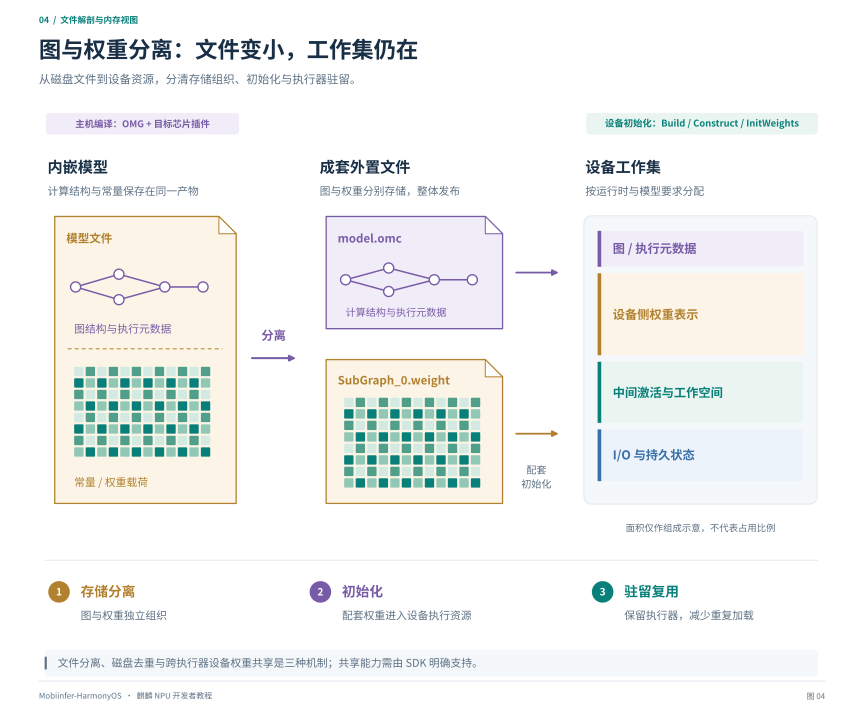
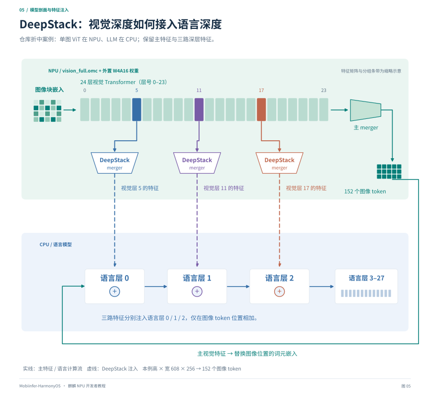

# 第四章：离线编译与图权重分离

[教程目录](README.md) · [上一章](03-operators.md) · [下一章：运行接口](05-runtime-apis.md)

## 1. 离线部署完成了哪些工作

离线部署把目标芯片相关的模型编译前移到开发主机。手机仍需检查兼容性、创建执行器、初始化权重、申请张量并提交计算。



*图 4：从内嵌模型文件到成套外置文件，再到设备工作集。图和权重独立存储后，设备仍需准备权重、激活、工作空间和 I/O；文件大小与图中面积均不代表实际设备占用。*

这条路线适合输入协议较稳定、需要避免首次手机在线编译的场景。但生成文件成功不等于模型已经可用：需要核对编译是否回退 CPU、设备是否接受图、I/O 是否匹配，以及输出精度。

## 2. 先决定图的边界

离线编译之前，应明确：

- 哪些计算在 CPU，哪些在 NPU。
- 输入是原始数据、预处理后的张量还是上游图的中间特征；有无 token ID、位置编码等额外输入。
- shape、dtype、layout 是否固定；需要几个尺寸档位。
- 输出是否包含后续阶段所需的中间结果，哪些持久状态需要读回、更新或直接在设备上保留。
- executor 是否跨请求保留，取消和卸载时如何处理。

全模型部署需要覆盖模型的全部主要计算，并明确跨阶段状态协议；分图部署则需要显式定义各子图的连接。对于自回归模型，prefill 与 decode 可以使用不同形状的图，KV Cache 是跨步保留的状态。图的合并或拆分应同时考虑编译峰值、执行器驻留、工作空间和边界拷贝。

## 3. 主机侧导出与编译

先确定图的输入输出协议，再完成导出、可选的量化校准与平台编译：

```text
源模型 → 接口与形状定义 → ONNX 导出
                          → 量化及配套参数（采用量化时）
                          → OMG 编译 → OMC 与权重 → 接口和数值核验
```

完整网络和子图使用相同的编译与加载机制。多图部署时，每张图均需保存自己的接口、量化参数和产物身份，并维护图间连接与状态。

### 3.1 OMG 编译参数

[external_weights.py](../../../transformers/llm/export/kirin_llm_offline/external_weights.py) 先将输入放到编译器可接受的临时目录，初始化 AscendC，再执行类似以下的命令结构：

```bash
# 参数结构示意：必须先设置 KIRIN_DDK、MODEL_ONNX、OUT_DIR、
# INPUT_SHAPES 和 QUANT_PARAMS，且它们指向本次构建的实际产物。
source "$KIRIN_DDK/tools/tools_ascendc/set_ascendc_env.sh"
"$KIRIN_DDK/tools/tools_omg/omg" \
  --model="$MODEL_ONNX" \
  --framework=5 \
  --output="$OUT_DIR" \
  --input_shape="$INPUT_SHAPES" \
  --target=omc \
  --platform=kirin9030 \
  --save_weights_as_external_data=true \
  --weight_data_type=FP16 \
  --compress_conf="$QUANT_PARAMS"
```

这是参数说明，不是一个可直接替代模型脚本的独立构建命令。特别是多输入 `input_shape`、量化权重 ONNX 和量化参数必须由同一次导出确定。

`--weight_data_type=FP16` 不能单独说明所有主干权重最终都是 FP16；W4 的编码与转换还由量化后的图和 `compress_conf` 决定。反过来，只加一份 W4 参数文件也不能把任意浮点 ONNX 正确变成已校准的 W4 模型。

这些选项的含义及适用版本参阅[官方 OMG 参数](https://developer.huawei.com/consumer/cn/doc/harmonyos-guides/cannkit-overall-parameter)。本项目额外使用的外置权重选项还需核对所用 DDK 的 `omg --help`，旧版文档未必列全。

### 3.2 检查编译结果

至少保留并检查：

1. 实际 `--target`、`--platform` 和完整命令。
2. 编译返回码与完整日志。
3. CPU fallback、未支持算子、形状/类型改写等记录。
4. 图与每份外置权重的大小及 SHA256。
5. 输入输出的名称、顺序、shape、dtype 与实际编译接口。
6. 配套参考验证报告和工具链版本。

`--platform` 用于选择目标平台，AscendC 环境与芯片插件仍需按工具链要求准备。使用仓库脚本完成初始化后，还应单独检查编译日志中的算子支持与执行位置。

## 4. 图与权重分离是什么意思

一个设备模型至少包含计算结构、执行相关信息和大量常量。开启图权重分离后，主要常量不再全部内嵌到同一个模型文件中，而由配套的外置文件提供。

```text
模型包
├── model.omc                       # 图与执行相关元数据
└── weights/model/SubGraph_0.weight  # 与本图配套的权重数据
```

这类分离同时适用于完整模型和模型子图。设备准备时仍需为权重、激活、I/O 与工作空间分配资源；小型图文件不代表完整工作集也很小。

### 4.1 三件不同的事

| 机制 | 解决什么 | 不能自动保证什么 |
| --- | --- | --- |
| 文件分离 | 图与权重独立存储、初始化 | 权重不再占设备内存 |
| 磁盘去重 | 相同权重只保存一份文件 | 多个 executor 共用一份设备权重 |
| 图/执行器常驻 | 同实例复用准备好的资源 | 任意数量图都能共存 |

尤其是 prefill 与 decode，即便指向同一个磁盘权重目录，分别创建 executor 仍可能付出各自的资源和初始化成本。若要实现设备权重共享，需要明确的受支持接口和生命周期协议，不能从文件名相同推导出来。

### 4.2 不要手工替换量化权重

OMC、外置文件、张量结构和量化参数必须对应。更新模型时整体发布并验证 manifest，不把旧 OMC 和新 `.weight` 拼在一起。权重文件的名字与相对目录也可能属于模型内部约定。

## 5. 手机端怎样加载外置权重模型

项目使用以下顺序：

```text
检查 OMC 与外置文件
  → HMS_HiAICompatibility_CheckFromFile
  → 枚举设备并选中 HIAI_F
  → ConstructWithOfflineModelFile
  → SetDevice / NPU device order / 禁用 fallback
  → OH_NNCompilation_Build
  → OH_NNExecutor_Construct
  → HMS_HiAIExecutor_InitWeights(executor, weightDirectory)
  → 查询 I/O、申请张量、校验端口绑定
  → RunSync
```

这里 `Build` 是 NNRT 生命周期的一部分。输入已经是 OMC，并不意味着这一步为空操作，也不能绕过它直接构造 executor。

`HMS_HiAIExecutor_InitWeights` 在本项目中按目标系统的实际符号和签名解析，参数是权重**目录**。这是 HiAI 扩展，不是通用 NNRT 或所有旧系统都必须提供的接口。设备端曾从 `libhiai_foundation.so` 显式句柄中成功找到它；只搜索 `RTLD_DEFAULT` 会受动态库可见性影响。

若能力不存在，应报告不支持并选择明确的兼容方案，不能略过初始化继续运行。库句柄、compilation、executor 和权重文件的生命周期要配套管理；本实现对外置权重路径保留 compilation，直到 executor 销毁后再释放。

第五章给出更具体的接口表与初始化片段。

## 6. 仓库案例：全模型离线 NPU

本仓库已支持将 Mobi/Qwen3-VL 的 ViT、文本 embedding、语言 decoder 和 LM head 编译为离线图，并在 NPU 执行。CPU 负责分词、输入组织、位置与 mask 构造、状态写回和采样等调度工作。

采用视觉合图、每个语言图覆盖全部 28 层的构建时，模型由六张 OMC 组成：

| 图 | 主要计算 |
| --- | --- |
| `vision_full` | 完整 ViT、最终 merger 与三路 DeepStack merger |
| `embedding_prefill` / `embedding_decode` | 两种输入形状的文本 embedding |
| `llm_prefill_0` / `llm_decode_0` | prefill 与逐 token decode 的语言主干 |
| `lm_head` | 最终 norm 与词表投影 |

```text
图片 → NPU ViT ──────────────→ 主视觉特征与 DeepStack
                                            ↓
文本 token → NPU embedding → 特征组织 → NPU decoder → NPU head → 采样
                                            ↑                      │
                                            └── KV 与生成状态更新 ──┘
```

这里“全模型”表示主要神经网络计算的 NPU 覆盖范围。prefill/decode 分图、CPU 控制的生成循环和设备图驻留策略共同组成运行时。

全模型路径使用外置 W4/group64 主干权重和 FP16 KV。编译产物可生成，精度已取得阶段性进展；主要资源约束在于完整的图、权重、KV、激活和工作空间需要占用设备内存。工作集无法同时驻留时，运行时会淘汰图并重新加载，解码阶段逐 token 重复初始化权重会显著拖慢速度。

全模型构建入口为 [external_weights.py](../../../transformers/llm/export/kirin_llm_offline/external_weights.py)。已有配套冻结校准构建时，可按[全图 NPU 构建说明](../../inference/full-npu-kirin9030.md#42-有冻结-w4-构建时直接重建外置图)准备路径，再导出、编译全部组件：

```bash
"$KIRIN_CPU_PY" -B "$KIRIN_TOOLS/external_weights.py" \
  --source-build "$KIRIN_FROZEN_W4" \
  --output "$KIRIN_BUILD" --model "$KIRIN_MODEL" --ddk "$KIRIN_DDK" \
  --layers-per-chunk 28 --kv-dtype fp16 \
  --activation-range-multiplier 1 --output-range-multiplier 4 \
  --fuse-vision \
  --components llm,head,embedding,vision --steps prepare,export,compile
```

该命令沿用对应冻结构建的量化状态与形状；重新校准、打包和 CPU 回放步骤见同一构建说明。下一节的 `setup.sh model` 面向混合部署包，不能据其名称把两套产物与入口混用。

## 7. 仓库案例：单图 ViT 与 CPU LLM 的折中部署

设备内存不足以高效维持全模型工作集时，一种折中是将 LLM 留在 CPU，仅将 ViT 放在 NPU。本仓库这一实现将 **完整 ViT、最终 merger 和三路 DeepStack merger** 合并成 `vision_full.omc`。图像解码、resize、patch 排列等仍在 CPU；文本 embedding、LLM、head、采样和语言 KV 也在 CPU。



*图 5：以视觉网络深度为横轴，标出第 5、11、17 层的特征抽取及对应 merger，虚线连接语言层 0、1、2 的图像位置加法。外围实线单独追踪主视觉 embedding。本图是仓库混合部署案例。*

### 7.1 模型协议与 DeepStack

本例视觉协议使用高 608、宽 256，patch16、temporal2、merge2：

```text
608 × 256 像素
  → 38 × 16 = 608 个视觉 patches
  → merger 后 19 × 8 = 152 个语言图像 token
```

图的主要输入为：patches、position indices/weights、视觉 RoPE cos/sin、attention mask。输出为主图像 embedding 和三路已经投影的 DeepStack。

视觉 layers **5/11/17** 的三路特征依次注入语言 layers **0/1/2**，不是语言层 5/11/17。这是该 Mobi/Qwen3-VL 导出协议，不能照搬到任意视觉模型。

把八段视觉图合成一张，能减少图边界与重复加载的机会，但可能改变编译峰值和 workspace。单图能否运行必须实际验证，不能只根据图文件尺寸推断。

本项目验证过的视觉实例中，OMC 约 5.27 MB，外置权重为 251,344,384 bytes。它说明图文件明显变小，并不说明 NPU 只需要 5.27 MB 内存。

### 7.2 配置混合模型输入

准备好第一章的主机环境，编辑 [model_config.sh](../../../project/harmony/model_config.sh)。至少确认：

| 输入 | 用途 |
| --- | --- |
| 原始 HF 模型 | 浮点参考、离线视觉导出与新校准 |
| 配套 GPTQ 模型 | 当前 MNN CPU LLM 和在线视觉的量化权重来源 |
| 校准图片 | 离线视觉权重优化与激活范围估计 |
| 独立验证图片 | 检查导出和量化误差，不参与校准 |
| DDK、插件和 Python 环境 | 执行量化、转换和编译 |

本项目默认原始与 GPTQ 模型均指向 Mobi；缺少默认本地模型时可从 ModelScope 下载。SDK 需自行准备，校准图片和独立验证数据也需提供。修改路径不会让脚本自动支持任意新架构。

重新执行 GPTQ 权重优化通常需要配置好的 CUDA 校准环境。复用冻结校准结果可以跳过该阶段，但仅有已发布 OMC/权重运行包不足以恢复完整校准状态。

### 7.3 构建混合部署包

```bash
# 查看计划，不运行模型导出和编译
bash project/harmony/setup.sh model --dry-run

# 执行工具准备、MNN 导出、视觉校准、验证、编译和打包
bash project/harmony/setup.sh model
```

按需要选择阶段：

```bash
bash project/harmony/setup.sh model \
  --stages tools,mnn,calibrate,vision,verify,compile,package
```

阶段存在前置产物依赖。不能删除校准阶段后，把一份不配套的 `quant_params_file` 临时补给新的 ONNX；需要按 manifest 复用对应的完整状态。

### 7.4 混合部署包与 App

双模式包需要同时保留在线 MNN 视觉和离线视觉资产，两者格式不能互相替代：

```text
config.json                       # App 入口
llm_config.json
llm.mnn / llm.mnn.weight           # CPU LLM
tokenizer.mtok / embeddings_bf16.bin
visual_pre.mnn / ...               # 在线视觉
visual_blocks_npu_*.mnn / ...
visual_post.mnn / ...
vision/
├── config.json
├── vision_constants.bin
├── om/vision_full.omc
└── weights/.../SubGraph_0.weight
```

App 中“离线 NPU”对应当前单图混合路线。内部标识继续使用 `offline_npu2` / `kirin_offline_npu2_v1`，避免破坏已发布包和持久化配置。全模型 NPU 使用本章第六节的独立运行包与配置入口；此处 App 按钮描述的是已发布混合部署包的行为。

执行器应在模型加载时准备，并跨图片复用；请求结束无需自动卸载。用户切换模型、显式卸载或资源恢复时，再按序释放。这样既减少反复初始化，也能明确控制模型占用。

## 源码入口

- [构建流水线](../../../project/harmony/model_pipeline.py)：阶段执行与前置产物校验。
- [外置图编译](../../../transformers/llm/export/kirin_llm_offline/external_weights.py)：OMG 参数、产物与编译日志。
- [全模型 NPU 运行时](../../../transformers/llm/export/kirin_llm_offline/runtime/FullNpuRuntime.cpp)：embedding、视觉、prefill、decode、head 与状态调度。
- [单图混合包打包](../../../transformers/llm/export/kirin_hybrid_offline/package_runtime.py)：CPU 模型、在线视觉与离线视觉组合。
- [单图混合运行时](../../../transformers/llm/export/kirin_hybrid_offline/runtime/OfflineNpu2.cpp)：视觉到 CPU LLM 的桥接。
- [NNRT 后端](../../../transformers/llm/export/kirin_llm_offline/runtime/NnrtBackend.cpp)：兼容性、外置权重、执行器和 I/O。
