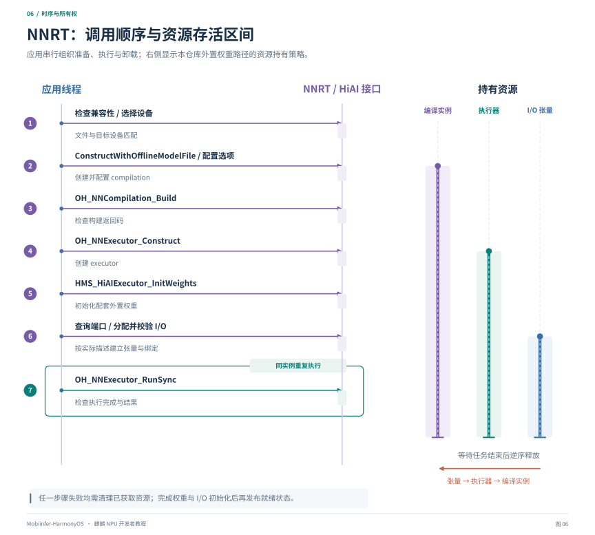

# 第五章：运行接口与资源管理

[教程目录](README.md) · [上一章](04-offline-and-external-weights.md) · [下一章：量化与精度](06-quantization-and-accuracy.md)

## 1. “驱动提供的下发接口”在应用里是什么

应用看到的通常是用户态接口：MNN 后端、HiAI 模型管理接口、NNRT 以及 HiAI 扩展。它们再通过运行时和系统服务与驱动交互。本教程不涉及未公开的驱动 ioctl、固件命令或寄存器协议。

应按所用路线选一套完整生命周期：

| 路线 | 编译/准备 | 下发与加载 | 执行 | 释放 |
| --- | --- | --- | --- | --- |
| 本项目普通 HiAI C++ 在线路径 | `HiaiIrBuild::BuildIRModel` | `AiModelMngerClient::Load` | `AiModelMngerClient::Process` | `UnLoadModel` 及相关对象释放 |
| NNRT 在线模型 | 构造 `OH_NNModel` 后创建 compilation，调用 `Build` | 由 compilation/executor 生命周期完成 | `RunSync` / 对应异步接口 | 张量、executor、compilation、model 分别销毁 |
| NNRT 离线 OMC | `ConstructWithOfflineModelFile` 后调用 `Build` | `OH_NNExecutor_Construct`，外置权重再初始化 | `OH_NNExecutor_RunSync` | 张量 → executor → 保留的 compilation |
| HiAI 单算子 API | 创建描述、选项及执行器，按接口初始化 | 算子执行器初始化 | `HMS_HiAISingleOpExecutor_Execute` | 单算子句柄与缓冲区释放 |

普通 HiAI C++、NNRT 和单算子 API 的张量/执行器不是同一种对象，不应强转后交叉使用。仓库的 HCL/显式插件路径也有独立封装，参见 [HiaiHclV600Runtime](../../../source/backend/hiai/backend/HiaiHclV600Runtime.hpp)，不能只根据函数名相似混接。

## 2. HiAI C++ 在线路径

### 2.1 构图和编译

| 对象/接口 | 作用 |
| --- | --- |
| `hiai::op::*` / `ge::Operator` | 建立已有算子及其属性、输入连边 |
| `ge::Graph::SetInputs / SetOutputs` | 定义图的输入输出边界 |
| `ge::Model::SetGraph` | 建立待编译模型 |
| `domi::HiaiIrBuild::CreateModelBuff` | 准备编译输出缓冲区 |
| `domi::HiaiIrBuild::BuildIRModel` | 将模型交给设备侧编译链路 |
| `ReleaseModelBuff` | 释放相应编译缓冲区 |

IR 中的 `Const` 携带权重等数据，构图本身就可能消耗大量主机内存。不要为了调试在每次请求里额外序列化一份包含所有权重的 IR。本项目只在专门调试分支保存这类数据。

### 2.2 加载与执行

`AiModelMngerClient::Init` 初始化客户端；模型数据通过 `AiModelBuilder::InputMemBufferCreate` 等接口建立描述，再交给 `Load`。成功后查询 I/O，创建 `AiTensor`，按模型名和正确的张量顺序执行 `Process`。

本项目记录 `Process` 的同步调用耗时。不要将它与包括图构建、图加载和视觉前后处理的完整耗时混称为“NPU 计算时间”。相关实现集中在 [NPUBackend.cpp](../../../source/backend/hiai/backend/NPUBackend.cpp) 的构图、`LoadModelSync`、I/O 查询和执行方法中。

## 3. NNRT 与 HiAI 扩展接口速查

NNRT 的编译、执行与张量接口主要在 `neural_network_runtime/neural_network_core.h`，在线模型构图还需查看 `neural_network_runtime/neural_network_runtime.h`；具体链接依赖以所用 SDK 为准，本文离线片段使用 `libneural_network_core.so`。HiAI 扩展来自匹配 SDK 的 `CANNKit/*.h` 及系统实现。接口详细契约参见 [NNRT Core API](https://developer.huawei.com/consumer/cn/doc/harmonyos-references/capi-neural-network-core-h)、[在线构图 API](https://developer.huawei.com/consumer/cn/doc/harmonyos-references/capi-neural-network-runtime-h) 和 [CANN API 模块](https://developer.huawei.com/consumer/cn/doc/harmonyos-references/cannkit)。

### 3.1 设备与能力

| 接口 | 作用 | 使用要点 |
| --- | --- | --- |
| `OH_NNDevice_GetAllDevicesID` | 枚举已对接设备 | 查询真实 ID，不写死为 0 |
| `OH_NNDevice_GetName` | 查询设备名 | 本项目选择名为 `HIAI_F` 的后端；名称是项目匹配条件 |
| `HMS_HiAI_GetVersion` | 查询 HiAI/CANN 运行版本 | 版本来自手机，不等于主机 DDK 版本 |
| `HMS_HiAICompatibility_CheckFromFile/Buffer` | 检查模型兼容性 | 不兼容应重新构建或使用明确兼容路线 |

设备枚举和版本查询都不能代替模型算子支持性、资源和数值验证。NNRT 返回的设备 ID 与 MNN 后端枚举属于不同命名空间。

### 3.2 模型与编译实例

| 接口 | 作用 |
| --- | --- |
| `OH_NNModel_Construct` 及构图 API | 建立 NNRT 在线模型描述 |
| `OH_NNCompilation_Construct` | 从在线 NNRT 模型建立编译实例 |
| `OH_NNCompilation_ConstructWithOfflineModelFile` | 从离线文件建立实例 |
| `OH_NNCompilation_ConstructWithOfflineModelBuffer` | 从离线内存建立实例 |
| `OH_NNCompilation_SetDevice` | 选择目标设备 |
| `OH_NNCompilation_SetCache` | 设置 NNRT 自身的编译缓存协议 |
| `OH_NNCompilation_Build` | 提交编译或完成对应模型的构建准备 |
| `OH_NNCompilation_Destroy` | 销毁实例 |

这些构造入口不能在一个实例中随意混用。buffer 入口需遵守 SDK 的借用内存生命周期；不能创建完 compilation 就立即释放它仍在引用的模型内存。

NNRT 还提供缓存导入/导出等接口，但本项目 MNN chunk OM 缓存是另一套封装。不要把 `SetCache`、MNN `setCache()` 和 `om_cache_v3` 当成同一个协议。

### 3.3 HiAI 扩展选项

| 接口 | 作用 | 本项目的使用边界 |
| --- | --- | --- |
| `HMS_HiAIOptions_SetModelDeviceOrder` | 设置执行设备顺序 | 离线后端选择 NPU |
| `HMS_HiAIOptions_SetFallbackMode` | 是否允许硬件选择回退 | 离线后端禁用，失败显式返回 |
| `HMS_HiAIOptions_SetBandMode` | 带宽相关偏好 | 不是可用内存扩容，也不保证速度提升 |
| `HMS_HiAIOptions_SetDeviceMemoryReusePlan` | 设备内存复用选项 | SDK 能力项，本项目主路径未据此建立通用跨 executor 权重共享 |
| `HMS_HiAIOptions_SetDynamicShapeStatus` | 动态 shape 相关选项 | 需连同算子、模型和缓存策略一起验证 |
| `HMS_HiAIOptions_SetQuantConfig` | 传入量化编译配置 | 不能代替配套量化模型和校准 |

上表来自 [HiAI options 参考](https://developer.huawei.com/consumer/cn/doc/harmonyos-references/cannkit-hiai-options-8h) 和项目所用接口。某版本有头文件声明，不代表目标设备上一定实现该能力；要检查返回码。

### 3.4 执行器和外置权重

| 接口 | 作用 |
| --- | --- |
| `OH_NNExecutor_Construct` | 从准备好的 compilation 创建执行器 |
| `HMS_HiAIExecutor_InitWeights` | 本项目使用的厂商外置权重初始化扩展 |
| `OH_NNExecutor_GetInputCount / GetOutputCount` | 查询端口数 |
| `OH_NNExecutor_CreateInputTensorDesc / CreateOutputTensorDesc` | 获取端口描述 |
| `OH_NNExecutor_RunSync` | 同步执行指定输入输出张量 |
| `OH_NNExecutor_RunAsync` 等 | 按 SDK 协议异步执行并通过回调接收结果 |
| `OH_NNExecutor_Destroy` | 释放执行器 |

`InitWeights` 在这里是项目已使用并在案例设备观察到的扩展，不应推广为通用 NNRT 的必备功能。解析、签名和库可见性处理见 [NnrtBackend.cpp](../../../transformers/llm/export/kirin_llm_offline/runtime/NnrtBackend.cpp)。

## 4. 离线执行器初始化片段



*图 6：左侧为应用到 NNRT/HiAI 接口的调用时序，右侧条带表示本仓库外置权重路径中资源的存活区间。准备完成后重复执行，卸载时等待任务结束，再按张量、执行器、保留的编译实例顺序释放。*

下面的函数只演示**已经选好设备之后**的模型初始化，不包含端口绑定或推理。`initWeights` 由调用方按目标 SDK 签名解析，并保持提供它的动态库存活。成功返回的两个句柄由调用方持有；失败时本函数清理已创建对象。

```cpp
#include <neural_network_runtime/neural_network_core.h>
#include <CANNKit/hiai_options.h>

using InitWeightsFn = OH_NN_ReturnCode (*)(OH_NNExecutor*, const char*);

bool prepareOffline(const char* modelFile, size_t deviceId,
                    const char* weightDir, InitWeightsFn initWeights,
                    OH_NNCompilation*& compilation, OH_NNExecutor*& executor) {
    // 两个输出参数必须是空句柄，避免覆盖调用方已有资源。
    if (compilation || executor || !modelFile) return false;
    auto fail = [&]() {
        if (executor) OH_NNExecutor_Destroy(&executor);
        if (compilation) OH_NNCompilation_Destroy(&compilation);
        return false;
    };
    compilation = OH_NNCompilation_ConstructWithOfflineModelFile(modelFile);
    if (!compilation) return false;
    if (OH_NNCompilation_SetDevice(compilation, deviceId) != OH_NN_SUCCESS)
        return fail();
    HiAI_ExecuteDevice devices[] = {HiAI_ExecuteDevice::HIAI_EXECUTE_DEVICE_NPU};
    if (HMS_HiAIOptions_SetModelDeviceOrder(compilation, devices, 1) != OH_NN_SUCCESS)
        return fail();
    if (HMS_HiAIOptions_SetFallbackMode(compilation, HIAI_FALLBACK_DISABLED) != OH_NN_SUCCESS)
        return fail();
    if (OH_NNCompilation_Build(compilation) != OH_NN_SUCCESS) return fail();
    executor = OH_NNExecutor_Construct(compilation);
    if (!executor) return fail();
    if (weightDir && weightDir[0] != '\0') {
        if (!initWeights || initWeights(executor, weightDir) != OH_NN_SUCCESS)
            return fail();
    }
    return true;
}
```

省略权重目录仅适用于不依赖外置初始化的模型，不能用来绕过外置模型缺少接口的错误。生产代码还需要在进入此函数前检查文件、兼容性，并记录失败步骤和原生错误码；成功后必须校验全部 I/O 才能将模型标记为可执行。

此片段沿用本项目的生命周期策略：外置模型保留 compilation，直到 executor 销毁后再释放。该策略不表示所有 NNRT 模型都要求如此；其他接入方式应按对应 SDK 的资源所有权契约管理。

## 5. 张量和端口绑定

核心接口包括：

- `OH_NNTensorDesc_GetName / GetShape / GetDataType / GetByteSize / GetFormat`：读取实际描述。
- `OH_NNTensor_Create`：创建设备关联张量。
- `OH_NNTensor_GetDataBuffer`：获取输入填充/输出读取所需的缓冲区地址。
- `OH_NNTensor_GetSize`：检查分配大小。
- `OH_NNTensor_Destroy / OH_NNTensorDesc_Destroy`：分别释放张量和描述符。

设备返回的描述是最终 I/O 契约。用它核对模型包中期望的名称、shape、dtype 和 layout，再建立顺序映射。名称需要有限度的标准化时，应限定规则并拒绝歧义；不能用“找一个大小一样的 tensor”代替绑定。

例如 `rope_cos` 与 `rope_sin`、K 与 V 可以完全同形，单纯的形状与容量检查无法识别它们被交换；应同时核对名称、顺序及数值语义。DeepStack 输出存在显式重复别名时，按导出协议处理。

填充完成后，按**设备端口顺序**组织输入/输出数组：

```cpp
// inputs/outputs 是已校验且存活的 std::vector<NN_Tensor*>。
OH_NN_ReturnCode code = OH_NNExecutor_RunSync(
    executor, inputs.data(), inputs.size(), outputs.data(), outputs.size());
if (code != OH_NN_SUCCESS) {
    // 返回错误；不要把上一次输出当成本次结果。
}
```

FP16 缓冲区不能直接作为 `float*` 读取。输出转成 FP32 供主机消费时，应计入输出处理开销，而不是将这段 CPU 转换算入设备计算。

## 6. 共享内存与“零拷贝”

NNRT 有 `OH_NNTensor_CreateWithFd` 等接口，部分后端也支持原生句柄。但一个 FD 并不自动满足设备约束，还需要核对分配器、offset、容量、对齐、格式、同步和句柄生命周期。

本仓库 [MNNHiAIIO.h](../../../source/backend/hiai/include/MNNHiAIIO.h) 的原生句柄协议中包含 Android `AHardwareBuffer` 语义，不能据此声称当前 Harmony App 已经实现同样的跨阶段零拷贝。是否省去了拷贝，应检查实际绑定路径、调用结果和 profiler。

同一张量在 CPU、NNRT 与模型图之间可能有不同的物理布局。共享内存只解决一部分数据访问问题，不会自动完成布局转换。

## 7. 线程、安全重试与释放

当前使用的 NNRT SDK 头文件注明 Neural Network Core 接口不支持多线程并发调用。应用应使用受控的串行执行队列或锁覆盖加载、执行、切换和卸载，按目标 SDK 的并发约束设计；异步 API 也不等于可以任意同时修改句柄。

资源释放按依赖逆序进行：

1. 停止提交请求，等待正在执行的同步调用或异步回调完成。
2. 释放输入输出张量及相关共享缓冲区。
3. 销毁 executor。
4. 销毁保留的 compilation 和在线 model。
5. 释放模型内存、回调上下文与动态库句柄。

初始化过程中，维度查询或第几个张量分配失败，都应清理已创建资源。只有全部检查成功才发布“模型已加载”状态；重试不能覆盖一个仍有效的旧实例，也不能无限递归重试。

编译成功但 `Construct` 返回空，需要单独诊断执行器与内存初始化；不能将其简单改写成“编译失败”。调用失败后不要继续读输出缓冲区。

## 8. 其他厂商能力与当前项目的边界

CANN Kit 还提供 AIPP、单算子及 LLM 引擎等接口，参考 [helper](https://developer.huawei.com/consumer/cn/doc/harmonyos-references/cannkit-hiai-helper-8h)、[单算子](https://developer.huawei.com/consumer/cn/doc/harmonyos-references/cannkit-hiai-single-op-8h) 和 [LLM 引擎](https://developer.huawei.com/consumer/cn/doc/harmonyos-references/cannkit-llm-engine)。

本仓库的全模型 NPU 路径使用 NNRT 管理 OMC，与厂商 LLM 引擎是不同的接入方式。使用后者时，模型格式、量化、tokenizer、平台和 API 版本需按其协议适配；MNN 的模型目录不能不经转换就直接交给它。主机工具版本较新，也不能提升手机系统的 API 等级。
