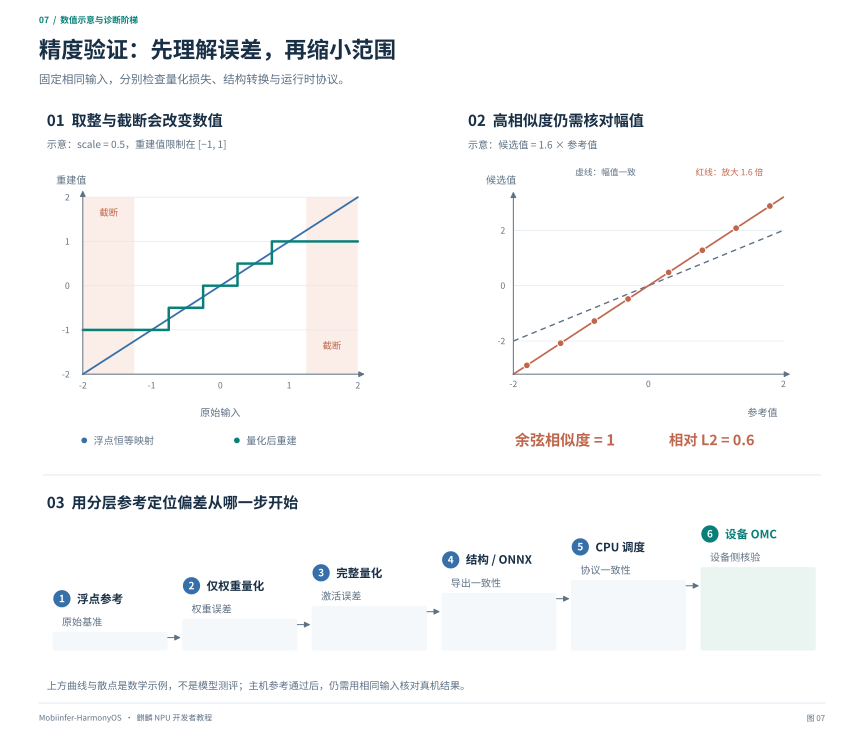

# 第六章：量化与精度验证

[教程目录](README.md) · [上一章](05-runtime-apis.md) · [下一章：性能与限制](07-performance-and-troubleshooting.md)

## 1. 量化方案必须描述完整

“这个模型是 4 bit”不足以描述运行方式。至少需要说明：

| 维度 | 需要记录的内容 |
| --- | --- |
| 对象 | Linear、Conv、embedding、head、norm、KV 分别如何处理 |
| 权重 | 位宽、对称/非对称、group size、分组方向、编码、scale、零点 |
| 激活 | 位宽、整数/浮点、静态/动态、per-tensor/per-channel/per-token 等 |
| 运算 | 乘法、累加、反量化与输出各是什么精度 |
| 例外 | 不压缩的层、特殊 head、敏感算子与共享权重 |
| 运行后端 | SDK 量化算子、MNN CPU 实际路径或其他实现 |

同样写作 W4A16 的两个模型，可以具有不同的整数编码和激活规则。应核对实际使用的量化算子及编译配置，明确 A16 对应的数值表示、范围和累加方式。

### 1.1 最基本的 scale 与零点

一般的线性仿射量化可以写成：

```text
q = clip(round(x / scale) + zero_point, qmin, qmax)
x_approx = (q - zero_point) * scale
```

`scale` 控制量化间隔；超出表示范围的值发生截断。分组量化给不同组使用不同参数，例如沿输入通道每 64 个权重一组。组的轴和排列必须明确，仅写 `group64` 仍不足以正确解码。

这只是基础模型。SDK 的 LUT/索引编码、舍入和特殊值规则可能不同，必须以实际格式解码，不能把上述公式当作任意厂商 W4 的完整解析器。

静态激活量化在校准时确定范围；动态激活量化在运行时根据当前张量计算参数。前者可能受输入分布变化影响，后者有在线统计开销。权重的 scale 不能替代激活的 scale。

## 2. 三种不同的概念：算法、格式与执行内核

### 2.1 GPTQ 是权重量化方法

GPTQ 利用校准输入统计，补偿权重近似引入的误差。它涉及量化算法与校准过程；校准时要观察相应层的输入，但不因此要求把所有激活也存成同一种整数格式。

与最简单的 RTN（按量化网格取整）相比，GPTQ 的目的是让压缩权重对实际输入产生更小影响。能否改善整模型质量，仍需对照实验。

### 2.2 “GPTQ 格式”是权重存储约定

源模型可能以 `qweight`、`scales`、`qzeros` 等字段组织，具体还取决于导出器。字段名相同也要核对打包顺序、分组、符号和零点约定。

AutoRound 是另一类量化优化方法，也可以把结果保存为 GPTQ 兼容格式。因此“AutoRound 量化、GPTQ 格式保存”并不矛盾：前者说明权重怎么得到，后者说明怎么保存和导入。

### 2.3 实际执行方式由后端决定

读取整数权重和 scale，只能重建或使用权重；它不能告诉运行时每次输入激活的范围。激活量化需要额外规则，例如离线校准的范围，或者运行时根据当前输入计算的动态 scale。

本项目 MNN 导入器处理源模型的量化权重整数和 scale，未整体导入旧 AutoRound 激活配置。MNN 的激活计算由目标模型和后端内核决定；权重导入正确与激活量化规则一致是两个独立检查项。验收时应记录实际算子路径并比较 MNN 输出，源配置中的 W8A8 标签不足以描述 MNN 的执行过程。

## 3. 按计算图制定量化方案

量化范围由待部署的计算图决定，既可以覆盖完整模型，也可以覆盖选定子图。规划时需要同时考虑内存、算子支持与精度：

1. 对占内存较多的矩阵选择低比特权重，并记录分组和编码；敏感层按验证结果保留更高精度。
2. 按实际执行后端确定激活量化规则，校准输入应覆盖部署时的形状和数据分布。
3. 对跨步保留的状态单独选择精度。语言模型的 KV Cache 可以采用 FP16 或受支持的量化格式，需要验证长上下文与多步误差。
4. 为图间接口规定类型、布局和量化参数。完整模型被拆成多图时，检查边界转换是否改变数值。

部署位置变化时，先对照实际输入、算子计算和状态协议，再决定是否需要重新量化。

## 4. DOPT 的三阶段流程

厂商文档给出权重量化、激活量化、参数提取三阶段。参阅[官方三段式量化](https://developer.huawei.com/consumer/cn/doc/harmonyos-guides/cannkit-llm-three-stage-quantification)及[量化效果评估](https://developer.huawei.com/consumer/cn/doc/harmonyos-guides/cannkit-llm-quantization-effect-evaluation)。

```text
原始浮点模型 + 校准输入
  → 权重量化/优化
  → 激活范围校准
  → 量化参数与配套模型导出
  → OMG 编译
```

典型产物的职责是：

- `trained_quant_weight.pth`：权重阶段的状态。
- `trained.pth` / 本项目对应的冻结 checkpoint：激活校准后用于参考验证和继续导出的状态。
- `fake_quant_weight.pth`：导出配套模型时使用的 SDK 权重表示。
- `quant_params_file`：编译时所需的量化参数。

这些名称来自具体工具版本，必须遵循该版本导出契约。“fake quant” 文件也不应仅凭名称被当成普通浮点权重；要检查其中是反量化数值，还是 SDK 索引/LUT 表示。

本项目的 W4 实现沿用 SDK 连续 group64，并在权重阶段使用 GPTQ 优化和逐矩阵误差审计。它不是完整移植厂商全部 KD/QAT 训练流程。

## 5. 校准数据怎样准备

校准应覆盖真实使用场景，例如截图文字、自然图片、表格、图文问答。保证预处理、分词模板、图片 token、RoPE 和 DeepStack 与实际导出路径一致，否则统计到的是另一种输入分布。

至少将数据分为：

1. **校准集**：用于估计范围和优化权重。
2. **验证集**：用于选择方案和发现回归，不参与校准。
3. **最终测试集**：在方案冻结后检验泛化与业务表现。

自回归模型应同时覆盖 prefill 与多步 decode；多模态模型应覆盖纯文本、带图输入及相应中间特征。样本数量、提示词分布和上下文长度应写入构建记录。

重新校准需要保存输入列表、随机种子、数据预处理、模型哈希、参数和工具版本。相同脚本重新运行未必产生相同 checkpoint；复现已发布结果时，优先复用经哈希核验的冻结构建。

## 6. 仓库案例：全模型量化与精度修正

本仓库提供全模型 NPU 和混合部署两类构建，各路径使用的量化协议如下：

| 路径 | 权重来源 | 主要格式/精度 |
| --- | --- | --- |
| 全模型 NPU | 原始模型及冻结量化构建 | 主干 W4/group64，特定层保留浮点，FP16 KV |
| 混合部署的离线单图 ViT | 原始浮点模型及冻结校准 | SDK W4A16/group64，包含各 merger 的量化配置 |
| 混合部署的在线 MNN ViT blocks | 配套 AutoRound/GPTQ 源模型 | W8/group128 导入；视觉 pre/post 和各 merger 保留浮点 |
| 混合部署的 CPU LLM | 同一份源 GPTQ 权重 | 主干 W8/group128，head 保留浮点 |

上述 SDK W4A16 路线的 A16 涉及 **signed INT16 输入与逐通道 INT16 输出量化**，需要按该量化算子的规则建立参考。

全模型 NPU 的冻结校准构建使用 32 张图片与 32 条文本输入，每组追加 4 步 decode；文本由 8 条提示词循环组成。这组数据用于工程校准，单图视觉构建的输入另按对应 manifest 核对。

排查历史精度问题时，采用以下分层对照：

| 现象 | 如何区分原因 | 已采用的处理及范围 |
| --- | --- | --- |
| 回答循环、重复或与输入无关 | 对比浮点、仅权重量化、完整激活量化 | 使用 GPTQ 候选并检查真实生成；不能仅依赖矩阵误差 |
| 量化图能转换，但数值很离谱 | 核对 initializer 是浮点还是 UINT4/LUT 索引 | 使用匹配的 `quant_param_2` 和参数文件重导；索引不能直接作为浮点权重 |
| 仅 W4 参考正常，完整参考明显变差 | 固定权重，只开关激活量化 | 调整范围并保留两条参考；冻结构建的输出范围系数 4 是模型特定选择 |
| CPU 参考正常，设备 hidden/logits 幅度严重偏离 | 固定并保存相同输入，检查中间值与 FP16 风险 | 采用稳定 RMSNorm、QK 预缩放、显式稳定 Softmax，降低中间幅度风险；这些改写不构成对历史唯一根因的证明 |
| 个别阶段正常，连续 decoding 变差 | 对照 M-RoPE、mask、每层 K/V 和生成前缀 | 修正状态协议并验证多步；prefill 通过不等于 decode 通过 |

稳定数学改写的例子：

- RMSNorm 在平方前按行缩放，降低大幅值平方溢出的风险。
- QK 点积之前把缩放分别分配给 Q 与 K，降低未缩放乘积的中间幅度。
- Softmax 显式减去每行最大值。

这些是浮点代数上的等价变形；在 FP16、量化取整和编译器融合后，不保证逐 bit 相同。改写后仍需重新对照结构参考和质量指标。

完整历史、具体公式和证据边界见[全图 NPU 精度记录](../../inference/full-npu-kirin9030.md)。

## 7. 没有手机时如何验证

CPU 不能直接执行 Kirin OMC 来证明设备结果正确。可做的是建立分层参考，把错误在上机之前尽可能定位清楚。



*图 7：上方通过数学示例说明量化的取整/截断，以及余弦相似度为 1 仍可存在幅值误差；曲线与散点不是模型实测。下方阶梯用于逐层定位偏差，最后一步将设备 OMC 输出与同输入的 CPU 参考比较。*

| 对照 | 主要检查什么 |
| --- | --- |
| 原始 HF vs 仅压缩权重参考 | 权重量化损失 |
| 仅权重参考 vs 完整量化参考 | 激活截断与取整的额外影响 |
| 完整量化 HF vs 静态/分块 Torch | 图拆分、mask、位置、缓存协议 |
| 静态 Torch vs CPU reference ONNX | ONNX 导出和图改写 |
| 原始 GPTQ vs MNN 编码审计 | 整数打包、scale、零点和分组 |
| 独立 Python vs portable C++ 调度 | tokenizer、模板、patch、DeepStack、M-RoPE、KV |
| 真机 OMC vs 保存输入的 CPU reference | 设备编译、内核、类型与实际 I/O；必须在设备上补做 |

### 7.1 不要拿索引 ONNX 当普通 reference

编译用 UINT4/LUT ONNX 的某些 FLOAT initializer 只是存储索引，不代表可以直接与浮点激活相乘。ONNX Runtime 应运行专门还原权重和量化操作的 `reference/model.onnx`。

审计应按每个 MatMul 路径检查索引、LUT、scale 与参数绑定。对共享的 embedding/head 还需检查：改写 head 时有没有意外污染原本保留浮点的 embedding。

### 7.2 保存和比较什么

先保存待部署图的原始输入、预处理结果、各阶段输出、量化参数和持久状态。语言模型还需保留 token ID、位置/RoPE、attention mask、首 token logits 与多步 K/V；多模态模型增加图像 patches、视觉 embedding 和 DeepStack 等对应特征。

建议同时报告：

```text
max_abs_error = max(abs(candidate - reference))
relative_L2 = norm(candidate - reference) / max(norm(reference), epsilon)
cosine = dot(candidate, reference) / (norm(candidate) * norm(reference))
NaN / Inf 数量
首 token、top-k、teacher-forced NLL 或任务指标
```

高 cosine 可能掩盖幅度错误；min/max 只能作快速异常线索；校验和只能证明字节变化或复现一致性。它们都不能独自证明量化准确。

比较连续 decode 时，应固定同一个前缀或使用 teacher forcing。两套模型第一步选了不同 token 后，自由生成继续分歧很正常；要把采样分歧和同输入计算误差分开。

### 7.3 不同“精度对齐”的含义

- 同一量化模型导出前后逐字节一致，证明的是该次转换保真。
- 量化模型与原始浮点的误差，说明量化自身损失。
- CPU bridge 与独立 CPU 参考一致，说明输入与调度协议正确。
- 真机输出与同量化参考一致，才覆盖设备执行链路。

不能把第一或第三种结论写成“与原始浮点、真机均无损”。误差阈值也要针对明确的比较对象制定，不能为了报告通过临时放宽。

## 8. 在本仓库复现验证

混合部署包的流水线会执行视觉参考与 GPTQ 导入审计，入口为：

```bash
bash project/harmony/setup.sh model --dry-run
bash project/harmony/setup.sh model
```

全模型 NPU 的构建与验证入口见[第四章的全模型案例](04-offline-and-external-weights.md#6-仓库案例全模型离线-npu)。需要单独定位时，按各脚本 `--help` 和对应构建 manifest 提供参数：

| 入口 | 用途 |
| --- | --- |
| [verify_hybrid_vision.py](../../../transformers/llm/export/kirin_llm_offline/verify_hybrid_vision.py) | 单图视觉 Torch/ONNX 参考与量化误差 |
| [audit_quantization.py](../../../transformers/llm/export/kirin_llm_offline/audit_quantization.py) | 权重、激活、logits 与生成质量分离比较 |
| [audit_gptq_weights.py](../../../transformers/llm/export/kirin_hybrid_offline/audit_gptq_weights.py) | 原 GPTQ 与 MNN 的整数/scale 审计 |
| [verify_host.py](../../../transformers/llm/export/kirin_hybrid_offline/verify_host.py) | 混合方案的 CPU bridge 与独立参考 |
| [verify_app_runtime.py](../../../transformers/llm/export/kirin_llm_offline/verify_app_runtime.py) | Full NPU portable 调度的 CPU 回放 |

这些入口不是对任意模型的自动兼容器。运行参数、构建目录与冻结量化状态必须匹配；保存失败项、比较对象和样本覆盖，不把“脚本执行结束”写成“所有精度指标通过”。
