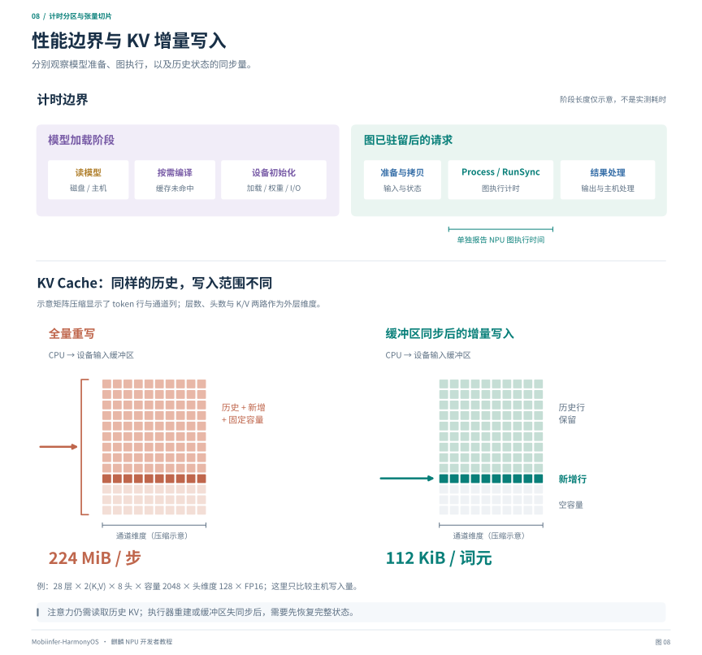

# 第七章：性能、限制与排错

[教程目录](README.md) · [上一章](06-quantization-and-accuracy.md)

## 1. 先把计时边界画出来

模型准备、图执行与持久状态传输的计时边界如下：



*图 8：上方分开模型加载与驻留后的请求计时，阶段宽度不表示耗时比例。下方将历史行、新增行和空容量展开成矩阵切片；增量写入仅更新新增行，前提是设备输入缓冲区持续同步。数值只比较主机写入量，不包含注意力读取或驱动内部搬运。*

完整模型包含多阶段或多张图时，分别统计各阶段及图间同步。语言生成应细分 embedding、prefill、首 token、多步 decode、head 和采样；图像等输入还需记录相应预处理。日志、调度、UI 和文件访问另行统计。

将设备准备前移后，其开销计入模型加载阶段。性能报告应同时保留“模型加载”和“请求执行”两个指标。

### 1.1 必须区分的测试状态

| 状态 | 条件 | 主要观察 |
| --- | --- | --- |
| 首次编译 | 无可复用缓存 | 编译时间、峰值资源、缓存是否成功落盘 |
| 磁盘命中后重载 | 旧实例已释放，磁盘缓存保留 | 缓存验证、设备加载、权重初始化 |
| 同实例热执行 | 图和执行器保留 | 稳态执行、拷贝与 CPU 前后处理 |
| 连续长时间运行 | 重复请求并观察温度/内存 | 降频、内存增长、资源恢复和取消重试 |

同步调用的耗时可以用单调时钟统计。异步接口必须测到完成回调或相应同步点，只测函数返回会得到排队/提交时间。

### 1.2 当前性能数据的正确含义

Kirin9030、Mobi 2B、App 竖图目标宽×高 270×600、模型对齐后宽×高 256×608 的历史测试中，六段在线 ViT blocks 的 `Process` 累计约 **0.66 秒**。

这个数只表示图执行接口的累计计时，**不包含** CPU 视觉 pre/post、图片处理、外部 I/O 拷贝、模型加载和首次在线编译，也不是整个图文回答时间。同一调用内部仍可能包含驱动调度等工作，不能将其解释为纯硬件算术单元占用时间。

不同日志中的完整视觉时间不能直接代替这个数；CPU 视觉约 8 秒与设备图时间也不是严格相同的阶段口径，不应据此直接声称整条请求加速了固定倍数。

## 2. 当前 NPU 的限制应如何理解

“限制”有四种来源，要分别看：

| 来源 | 例子 | 是否能靠本仓库代码调整 |
| --- | --- | --- |
| 模型/算法 | Attention 随序列增长、图像尺寸改变 token 数 | 可以改算法/形状，但需要精度和质量验证 |
| 框架/适配 | 某算子没有映射、缓存只有一个接口变体 | 可以实现或修复 |
| App 调度策略 | 常驻图数量、文件预算、何时释放 | 可以修改，但仍受设备资源约束 |
| SDK/系统/硬件 | 算子和 dtype 支持、ABI、可分配资源、API 等级 | 需要兼容实现或厂商能力，不能仅靠调大配置解除 |

下面讨论的是本项目已遇到或需要检查的边界，不给未公开的硬件容量、最大图数或并发规格下结论。

## 3. 内存：为什么图很小仍然加载失败

设备模型的资源不只包括磁盘文件：

```text
资源需求 ≈ 编译图/权重的设备表示
         + 中间激活与 workspace
         + 输入输出缓冲区
         + KV 或持久状态
         + 驱动与运行时元数据
         + 主机暂存副本及加载峰值
```

W4 文件也可能包含 scale、查表与未压缩层，并在某些准备阶段使用其他表示。不能把“文件大小 / 2”之类的估计当作实际设备占用。

`VmRSS` 主要反映进程驻留主机页，`MemAvailable` 是系统级估算，`CmaFree` 也只是一项内存线索。任何一项还有余量，都不能证明设备服务一定能创建另一个 executor；内存布局、碎片、workspace 与其他进程占用可能影响结果。

遇到 `Build` 成功、`OH_NNExecutor_Construct` 返回空，应优先把失败定位为执行器初始化阶段，再检查模型兼容性、资源、输入输出准备和系统日志。单靠这两行不能证明一定是某个固定内存上限。

## 4. 四张图、16 张图和 4 GiB 是什么

以本仓库全模型 NPU 运行时为例，常驻策略可以配置为：

```json
{
  "npu_max_resident_graphs": 16,
  "npu_resident_model_mib": 4096,
  "npu_persistent_kv_mib": 256,
  "npu_incremental_kv": true
}
```

这是策略示例，不是设备规格或对所有路径的默认值。旧包曾设置四张图和 2 GiB，调用方可通过 `ResidencyBudget` 覆盖部分预算；实际生效值应看 `cache_budget_override`、`cache_config`、`effective_max_graphs` 等日志。

`npu_resident_model_mib` 主要按图和外置权重文件统计，是**软件调度预算**，没有准确包含全部设备工作内存。将它设为 4096 不会向系统申请一个保证可用的 4 GiB NPU 配额。

资源失败时运行时会淘汰图、缩小工作集并进行有界重试，所以初始配置放宽也不等于执行过程中始终保有全部图。这组参数属于本仓库的 NNRT 图驻留策略；其他框架和运行时应核对各自的预算与资源管理接口。

## 5. 为什么循环解码特别怕反复加载图

例如每个 token 需要 embedding → decoder → head。如果设备只能保留其中一部分，执行 head 时卸载 decoder，下一个 token 又重新初始化 decoder，加载成本会被逐 token 放大。

```text
每 token 时间 = 必要的图/权重准备
             + 输入及 KV 同步
             + decoder / head 计算
             + 输出处理与采样
```

先统计加载次数、`resident_evict` 次数与 `load_ms` 总量，再用 `Construct`、`InitWeights` 等子阶段解释加载开销。`load_ms` 已包含的子阶段不能再次相加。外置图仍需初始化大权重，应据这些分项判断计算内核是否为主瓶颈。

可以优先保留高频 decoder、减少图切换，或在编译与执行资源允许时合并相邻子图。对完整工作集与端到端时间进行比较后，再决定常驻策略和计算划分。

## 6. KV Cache 的读写与同步开销

KV Cache 保存历史 token 的注意力 K/V，避免每一步重新生成历史 K/V。缓存有益，但读写和状态同步也有成本。

对逐层保存 K/V 的解码器，固定容量缓冲区可按以下公式估算：

```text
KV 字节数 = 层数 × 2(K,V) × KV 头数 × 容量 × 头维度 × 每元素字节数
单 token 新增字节数 = 层数 × 2 × KV 头数 × 头维度 × 每元素字节数
```

本仓库全模型 NPU 案例使用 28 层、8 个 KV heads、容量 2048、head dim 128、FP16，K/V 容量是：

```text
28 × 2(K,V) × 8 × 2048 × 128 × 2 bytes
  = 234,881,024 bytes = 224 MiB
```

如果每个 token 都从 CPU 完整写入这 224 MiB，就会产生不必要的搬运。设备输出新增 K/V、主机追加到缓存，再对保持同步的输入缓冲区只写新行，可把单 token 的主机增量写入降到：

```text
28 × 2 × 8 × 128 × 2 bytes = 114,688 bytes = 112 KiB
```

这只描述**主机写入量**，不代表 attention 不读取历史、不代表驱动零拷贝，也不代表图内已经实现原地 KV 更新。executor 重建、请求 epoch 变化、缓存裁剪或失去同步后，可能仍需全量写入。

查日志时对照 `kv_copied_bytes`、`kv_full_bytes`、`persistent_kv_bytes` 与图命中/淘汰。输入缓冲区跨 executor 共享还需确认设备、格式和布局相同，不能只看容量。

上述实现对应显式传入固定容量 KV 的 NNRT 图。使用其他缓存管理方式时，应按实际的数据所有权、布局和同步接口计算开销。

## 7. 形状、数据类型与图边界的限制

### 7.1 动态形状不是只打开一个开关

SDK 的动态形状选项需结合算子支持、内存规划、编译器和输出容量使用。固定形状的离线图要求遵守已编译的输入协议；改变图片分辨率、序列长度或状态容量时，需核对位置编码、mask 与缓冲区。

在线路径可为不同 shape 编译，但要管理档位数量和缓存增长。即便横竖图有相同 token 数，二维位置/预处理语义也需要核对，不能仅凭元素数量认定完整输入可互换。

### 7.2 类型支持随算子变化

接口层定义了 INT8、FP16、FP32 等类型，不等于每个算子都支持任意输入输出组合。LayerNorm/RMSNorm、Softmax、矩阵乘法与索引算子的类型约束尤其需要逐项确认。

以 FP32 描述输入，也不能保证编译器保留全部 FP32 中间值。较大幅值、平方和、指数和量化范围问题可能只在设备上出现。

### 7.3 回退既影响性能，也影响结论

框架有 CPU backup 和 SDK 可回退硬件是两层策略。应分别记录。不支持的算子导致零散 CPU 子图时，额外拷贝和同步可能抵消 NPU 收益。

离线后端采用禁止 fallback 的方式暴露错误；普通框架路径是否允许混合调度则由配置和后端逻辑决定。不能将“模型返回结果”直接标成“全图 NPU 成功”。

## 8. 排错速查

| 现象 | 先检查 | 常见误判 |
| --- | --- | --- |
| 选择在线 NPU，却没有 OM | 请求是否触发目标子图；实际 Runtime 是否 CPU；缓存目录与写权限 | 只看调用方的 enabled 日志 |
| `BuildIRModel` 失败 | 最早失败算子、属性、dtype、shape、常量与工具版本 | 只看最后一条通用错误 |
| OMC 不兼容 | 目标平台、OMG 版本、系统运行时与图来源 | 改扩展名或忽略兼容性返回值 |
| `Construct` 返回空 | 资源和生命周期；减少工作集；记录初始化阶段 | 把 Build 成功当作加载完成 |
| `InitWeights` 符号缺失 | 目标系统能力、库句柄可见性、实际 provider | 直接略过权重初始化 |
| 有缓存但重载仍慢 | 是否仍读取源权重、设备加载/初始化耗时、索引是否齐全 | 磁盘命中等于图驻留 |
| 第一次回答慢，后续快 | 编译/加载与真实计算分开统计 | 将全部时间计成 NPU 计算 |
| 图文回答无关 | 同输入对照预处理、端口顺序、量化编码、DeepStack、RoPE | 只凭 min/max 判定一定是量化 |
| decode 越跑越慢 | KV 同步量、图淘汰、固定容量 attention、温度与内存 | 认为有 KV 就不会有带宽问题 |
| 切换模型后偶发错误 | 请求与卸载是否串行、缓冲区/回调是否仍在用、源文件代次 | 反复重试掩盖生命周期问题 |
| `No custom_opp...` | 模型是否真的依赖额外自定义算子包 | 直接认为没有使用 NPU |

## 9. 一份有用的性能报告应包含什么

- 芯片、系统、HiAI 版本、App 和推理库版本。
- 模型与图/权重哈希、量化配置、输入图片和实际处理尺寸。
- CPU 线程配置、是否预热、是否有磁盘缓存、是否复用 executor。
- 模型加载、输入与状态准备、各图执行、图间同步；生成模型还需 prefill、decode 分项。
- 首 token 延迟、稳态 token/s、样本数及波动。
- 主机与设备相关资源线索、持续运行条件、是否出现回退/淘汰。
- 与同一个输入匹配的精度回归结果。

比较性能时保持输入、生成长度、后端配置和计时边界一致。关闭影响测量的逐张量 Debug 统计与大量日志，再保留必要的阶段计时。

## 10. 仓库案例：全模型驻留与混合部署的取舍

本仓库已支持全模型 NPU 编译与执行。性能优化首先需要关注完整工作集的设备内存：图、外置权重、KV、激活和 workspace 共同决定哪些实例能同时驻留。只检查 OMC 大小或放宽软件图数预算，无法确保全部执行器共存。

工作集超过可用资源时，优先定位图/权重重载与 KV 同步，再评估量化、上下文容量、分图和常驻策略。跨 executor 权重共享、图内状态更新与内核优化应结合 SDK 支持和目标设备验证推进。

一种资源与交互性能折中是 **ViT 在 NPU、LLM 在 CPU**。仓库的混合部署实现提供在线六段视觉图与离线单张视觉图，避免语言解码逐 token 切换 NPU 图；它们是针对当前工作集的部署选择，不限定 NPU 的计算覆盖范围。

配套记录：[全模型 NPU 性能与 KV](../../inference/full-npu-kirin9030.md)、[单图视觉混合部署](../../../transformers/llm/export/kirin_hybrid_offline/README.md)、[在线缓存验证](../../inference/mnn-upstream-integration.md)。
