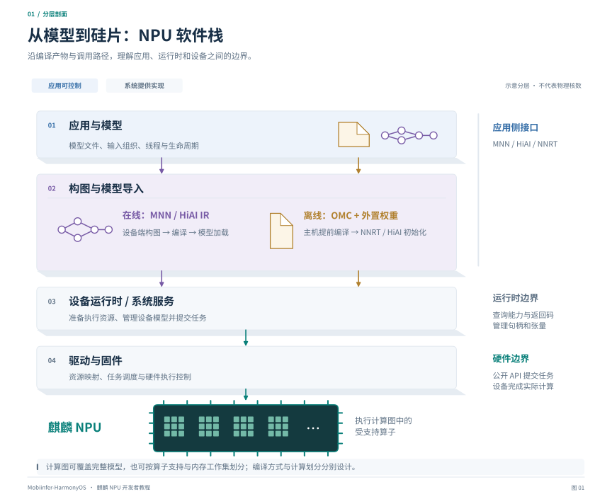

# 麒麟 NPU 开发教程

本教程面向希望在 **HarmonyOS + 麒麟芯片**上部署模型、接入推理框架或适配算子的开发者，介绍在线构图、离线编译、算子开发、模型加载、图权重分离、量化和性能分析。通用流程适用于受支持的计算图，包括视觉网络、语言模型及完整多模态模型。

阅读需要具备 C/C++、张量和模型推理的基本知识。各章先介绍通用机制，再用本仓库的 Mobi/Qwen3-VL 实现说明具体选择。



*在线与离线接入的软件栈。计算图可以覆盖完整模型，也可以是按算子支持与资源预算划分的子图。*

## 章节与阅读顺序

| 章节 | 内容 | 读完可以做什么 |
| --- | --- | --- |
| [一、架构、使用方式与开发环境](01-architecture-and-setup.md) | 软件栈、在线/离线/单算子路线、SDK 和编译环境 | 选择接入方式，分清主机工具与设备运行库 |
| [二、在线编译与 MNN 接入](02-online-compilation.md) | IR 构图、模块加载、后端确认、OM 缓存与预加载 | 运行 MNN 模型，确认图实际交给 NPU 执行 |
| [三、算子适配与 AscendC 开发](03-operators.md) | 框架算子映射、形状/布局/属性、Host Tiling、设备 Kernel | 判断需要补映射还是写内核，并建立验证流程 |
| [四、离线编译与图权重分离](04-offline-and-external-weights.md) | ONNX → OMG → OMC，外置权重，全模型与混合部署案例 | 构建、加载、复用匹配目标芯片的离线图 |
| [五、运行接口与资源管理](05-runtime-apis.md) | HiAI C++、NNRT C API、HiAI 扩展、张量与错误处理 | 理解编图、下发、初始化、执行、卸载分别调用什么 |
| [六、量化与精度验证](06-quantization-and-accuracy.md) | W4A16、GPTQ、AutoRound、DOPT、CPU 参考与真机验收 | 在没有手机时缩小精度问题范围，避免只看回答文本 |
| [七、性能、限制与排错](07-performance-and-troubleshooting.md) | 冷/热执行、内存、动态图、KV Cache、常见失败 | 找到瓶颈所在阶段，区分软件预算与设备能力 |

如果只想运行本项目：先读第一章的环境准备、第二章的在线步骤，或第四章的离线步骤。需要接入其他模型时，再读第三、六、七章。

## 案例与适用范围

- 模型：**Mobi 2B，基于 Qwen3-VL-2B**，由视觉编码器 ViT 与语言模型 LLM 组成。
- 设备案例：Kirin9030，项目运行记录中的 HiAI 版本为 `109.636.120.010`。
- **全模型 NPU**：仓库已支持 ViT、文本 embedding、语言 decoder 和 head 的离线编译与 NPU 执行，使用外置权重。全工作集常驻受设备可用内存约束；资源不足时的图淘汰和权重重载会显著拖慢推理，性能仍需优化。
- **混合部署折中**：在设备资源与交互性能之间权衡，将 ViT 放在 NPU、LLM 放在 CPU。仓库提供在线分块视觉与离线单图视觉两种实现，后者将完整 ViT、merger 与 DeepStack 合并到一张 OMC。

计算划分与在线/离线编译是两个独立维度。教程中的通用接口与流程不预设 LLM 必须放在 CPU；案例中的模型结构、图划分、缓存策略和性能数据对应本仓库及目标设备。

示例的使用范围如下：

| 类型 | 使用方式 |
| --- | --- |
| 仓库构建脚本 | 配置工具、模型与数据路径后执行 |
| MNN 集成函数 | 接入已链接原生库的 Harmony 工程，按模型修改输入输出协议 |
| NNRT / AscendC 片段及伪代码 | 说明接口与算法步骤；需补齐工程、资源管理和平台约束后编译验证 |

## 验证要点

1. **执行位置**：检查实际后端、编译/加载和执行结果；允许 CPU 回退时记录分图边界。
2. **缓存状态**：分别记录磁盘命中、设备加载、权重初始化与图驻留。
3. **数值正确性**：对照预处理、布局、量化编码、RoPE、DeepStack 与 KV 更新，验证完整模型协议。

## 配套工程与官方资料

本教程是使用说明，具体实现位置在各章末尾给出。项目的复现记录继续保留在：

- [主仓库 README](../../../README.md)：构建脚本、默认模型和 App 入口。
- [全图 NPU 构建与验证](../../inference/full-npu-kirin9030.md)：全模型编译、外置权重、冻结量化产物与精度验证。
- [单图视觉离线 NPU](../../../transformers/llm/export/kirin_hybrid_offline/README.md)：ViT 在 NPU、LLM 在 CPU 的折中实现与桥接协议。
- [主线集成与缓存验证](../../inference/mnn-upstream-integration.md)：在线后端、缓存与验证边界。

官方能力概览见 [CANN Kit 产品页](https://developer.huawei.com/consumer/cn/sdk/cann-kit/)，具体版本以目标设备、SDK 头文件和对应版本文档为准。本文将“官方提供的能力”“仓库实现的行为”和“需要设备验证的优化”分开说明。

## 配图与重绘

配图按教学内容分别采用分层剖面、时间轴、分块矩阵、资源时序和数值曲线，统一中文排版与配色。标题、标签和说明均为中文，保留 API 名称、文件名与必要的技术缩写。SVG 可在 GitHub 或浏览器中放大查看；图中的核数、内存面积和阶段长度均为示意，相应数值示例另有标注。

| 配图 | 内容 |
| --- | --- |
| [图 1：软件栈剖面](figures/01-software-stack.svg) | 在线/离线路径在系统运行时汇合，以及软件与硬件边界 |
| [图 2：缓存阶段对比](figures/02-online-cache-lifecycle.svg) | 用对齐时间轴辨认首次编译、磁盘命中与驻留分别省去哪类工作 |
| [图 3：算子分块与流水](figures/03-operator-development.svg) | 框架适配、数据分片、局部缓冲与双缓冲排程 |
| [图 4：文件与内存解剖](figures/04-offline-external-weights.svg) | 图权重分离前后的文件组织与设备工作集组成 |
| [图 5：DeepStack 特征注入](figures/05-hybrid-vit-deepstack.svg) | 在 24 层视觉网络中定位抽取层，追踪三路特征进入语言层 |
| [图 6：接口时序与资源存活](figures/06-nnrt-lifecycle.svg) | 将调用顺序与 compilation、executor、I/O 的持有区间对应 |
| [图 7：误差示意与验证阶梯](figures/07-accuracy-validation.svg) | 取整/截断、相似度与幅值的区别，以及分层定位方法 |
| [图 8：计时分区与 KV 切片](figures/08-performance-kv.svg) | 分离准备/执行计时，并直观看到 KV 全量与新增行的写入范围 |

[重绘脚本](figures/generate_figures.py)使用 Matplotlib 和中文字体。安装中文字体后，在仓库根目录执行以下命令即可重新生成所有 SVG；也可用 `--font /path/to/chinese-font.otf` 指定字体文件，例如 [Noto Sans CJK SC](https://github.com/notofonts/noto-cjk)。字体轮廓已写入 SVG，查看成品无需安装字体。

```bash
python3 docs/developer/kirin-npu/figures/generate_figures.py
```
